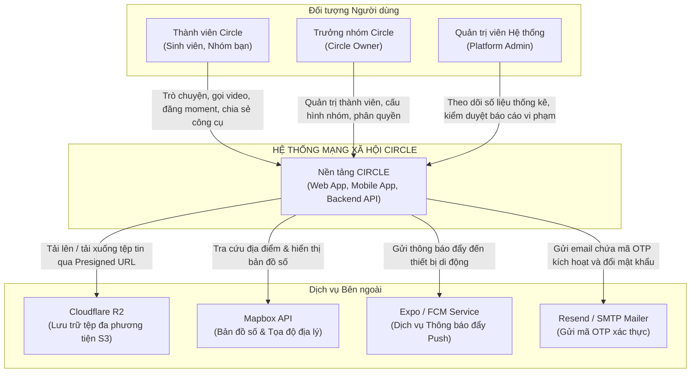
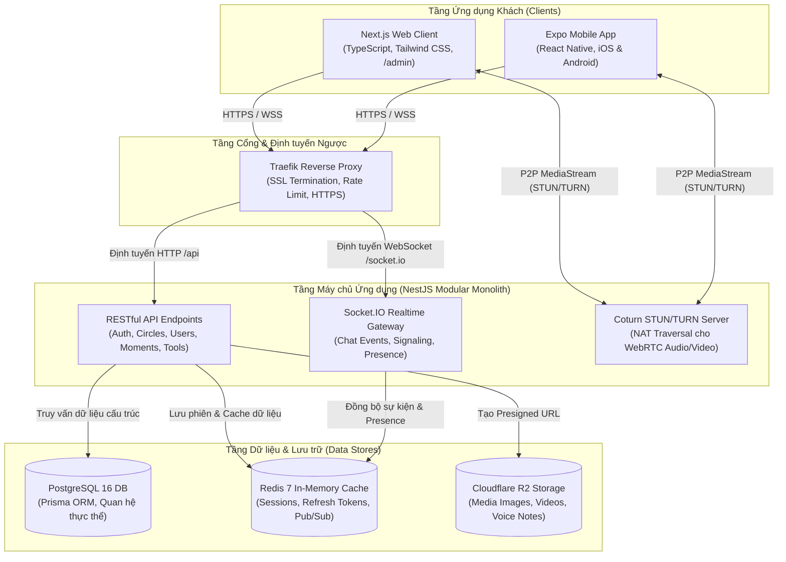
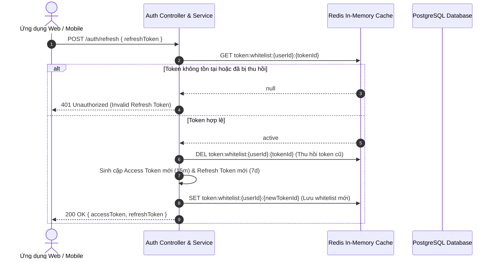
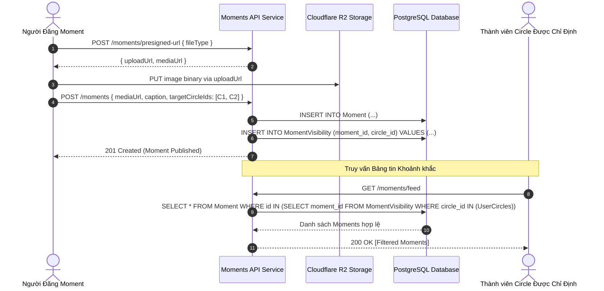

# TÀI LIỆU THIẾT KẾ PHẦN MỀM — SOFTWARE DESIGN DESCRIPTION (SDD)
## DỰ ÁN: NỀN TẢNG MẠNG XÃ HỘI KẾT NỐI VÀ TƯƠNG TÁC NHÓM — CIRCLE

> **Dự án:** CIRCLE  
> **Chuyên ngành:** Công nghệ Phần mềm — Khoa Công nghệ Thông tin — Trường ĐH Sư phạm Kỹ thuật TP.HCM  
> **Sinh viên thực hiện:**  
> - Trương Công Bình — MSSV: `23110184` (Technical Lead & System Architect)  
> - Ninh Thị Mỹ Hạnh — MSSV: `23110210` (Business Analyst & QA Lead)  
> **Giảng viên hướng dẫn:** ThS. Nguyễn Trần Thi Văn  
> **Phiên bản tài liệu:** `v2.0-RELEASE` — Cập nhật ngày 18/11/2026

---

## 1. TỔNG QUAN KIẾN TRÚC HỆ THỐNG

### 1.1. Mục tiêu và Phong cách Kiến trúc (Architectural Style)
CIRCLE được thiết kế dựa trên phong cách **Modular Monolith phân tầng kết hợp Truyền thông Thời gian thực phân tán (Event-Driven Realtime Modular Monolith)**:
- **Tính đóng gói mô-đun (High Cohesion & Low Coupling):** Toàn bộ mã nguồn máy chủ NestJS được chia thành 12 module nghiệp vụ độc lập, mỗi module quản lý riêng biệt Controllers, Services, DTOs và tương tác qua các hợp đồng dữ liệu rõ ràng.
- **Tách biệt tầng dữ liệu:** Cơ sở dữ liệu quan hệ **PostgreSQL 16** lưu trữ dữ liệu bền vững, kết hợp bộ nhớ đệm **Redis 7** chịu tải phiên làm việc, Refresh Token và đóng vai trò Pub/Sub message broker cho WebSocket cluster.
- **Xử lý tệp tin phi tập trung:** Toàn bộ dữ liệu phương tiện (ảnh, video, ghi âm) được tải trực tiếp lên bộ nhớ đám mây tương thích S3 (**Cloudflare R2**) thông qua cơ chế Presigned URL, giải phóng hoàn toàn băng thông của máy chủ backend.
- **Hệ thống truyền thông thời gian thực tự chủ:** Sử dụng **Socket.IO** cho tin nhắn/sự kiện và máy chủ **Coturn (STUN/TURN)** độc lập trên Linux VPS cho đàm thoại WebRTC Audio/Video.

---

## 2. MÔ HÌNH HÓA KIẾN TRÚC THEO C4 MODEL

### 2.1. C4 Level 1: Ngữ cảnh Hệ thống (System Context Diagram)

### 2.2. C4 Level 2: Vùng chứa Dịch vụ (Container Diagram)

### 2.3. C4 Level 3: Phân rã Thành phần Máy chủ (Component Diagram: `apps/api`)

Tầng Backend được chia thành 12 phân hệ nghiệp vụ chính:
- `AuthModule`: Quản lý JWT Access Token, Refresh Token Rotation, bảo mật mật khẩu `bcrypt`, Role Guards.
- `UsersModule`: Quản lý hồ sơ cá nhân, quan hệ bạn bè, tra cứu người dùng.
- `CirclesModule`: Quản lý vòng đời Circle, cấu hình chế độ gia nhập, mã mời, phân quyền Owner/Member.
- `ChatModule`: Quản lý kênh thảo luận, Socket.IO Chat Gateway, lưu trữ tin nhắn, reactions, ghim tin nhắn.
- `MomentsModule`: Quản lý đăng ảnh khoảnh khắc, kiểm duyệt bảo mật Circle-based privacy, phản hồi chuyển thành tin nhắn.
- `CallsModule`: Quản lý phiên gọi thoại/video WebRTC, Socket.IO Signaling Gateway, điều phối ICE Candidates.
- `CircleToolsModule`: Bộ 7 công cụ tương tác nhóm (Planning Sheet, Live Location Mapbox, Group Poll, Shared Album, Group Calendar RSVP, Decision Wheel, Hòm thư ẩn danh).
- `NotificationsModule`: Trung tâm thông báo In-app và tích hợp dịch vụ Push Notification đa nền tảng.
- `ModerationModule`: Hệ thống tiếp nhận báo cáo vi phạm, hàng đợi kiểm duyệt và nhật ký kiểm tra Audit Log.
- `AdminModule`: Tổng hợp số liệu thống kê Dashboard, quản trị toàn diện người dùng và nhóm.

---

## 3. THIẾT KẾ CƠ SỞ DỮ LIỆU & LƯỢC ĐỒ THỰC THỂ (ERD)

Cơ sở dữ liệu được định nghĩa bằng **Prisma ORM** tại [`apps/backend/prisma/schema.prisma`](../../apps/backend/prisma/schema.prisma). Các chỉ mục đa chiều (Composite Indexes) được đánh dấu tỉ mỉ để tối ưu hóa hiệu năng truy vấn:

- `User`: Quản lý thông tin định danh và tài khoản người dùng (`id`, `email`, `password_hash`, `display_name`, `avatar_url`, `role`, `status`).
- `Circle`: Quản lý thực thể không gian nhóm (`id`, `name`, `description`, `avatar_url`, `invite_code`, `join_mode`, `owner_id`).
- `CircleMember`: Bảng liên kết trung gian giữa User và Circle (`circle_id`, `user_id`, `role`, `nickname`, `joined_at`). Index: `@@unique([circle_id, user_id])`.
- `Channel`: Quản lý các kênh thảo luận nội bộ gắn liền với Circle (`id`, `circle_id`, `name`, `type`).
- `Message`: Lưu trữ tin nhắn thời gian thực (`id`, `channel_id`, `sender_id`, `content`, `reply_to_id`, `is_pinned`, `created_at`). Index: `@@index([channel_id, created_at])`.
- `Moment`: Lưu trữ bài đăng khoảnh khắc (`id`, `author_id`, `media_url`, `caption`, `created_at`).
- `MomentVisibility`: Quản lý quyền riêng tư phân phối bài viết theo từng Circle (`moment_id`, `circle_id`). Index: `@@unique([moment_id, circle_id])`.
- `CallSession`: Quản lý phiên đàm thoại WebRTC (`id`, `circle_id`, `initiator_id`, `type`, `status`, `started_at`, `ended_at`).

---

## 4. THIẾT KẾ LUỒNG NGHIỆP VỤ & SƠ ĐỒ TUẦN TỰ (SEQUENCE DIAGRAMS)

### 4.1. Luồng Xác thực: JWT Rotation với Redis Blacklist

### 4.2. Luồng Chia sẻ Khoảnh khắc: Circle-based Privacy Engine

---

## 5. THIẾT KẾ TRIỂN KHAI VÀ BẢO MẬT HẠ TẦNG

- **Môi trường Container hóa:** Sử dụng **Docker Multi-stage Builds** để thu gọn kích thước hình ảnh ứng dụng xuống dưới 150MB.
- **Bảo mật mạng và Định tuyến:** Traefik tự động chuyển hướng toàn bộ lưu lượng HTTP sang HTTPS, tự động gia hạn chứng chỉ Let's Encrypt SSL, áp dụng Rate Limiting tối đa 100 requests/phút đối với các endpoint nhạy cảm (auth, otp).
- **Phân tách biến môi trường:** Tuyệt đối không commit file `.env`. Mọi cấu hình nhạy cảm được nạp an toàn từ nền tảng VPS và GitHub Repository Secrets.
