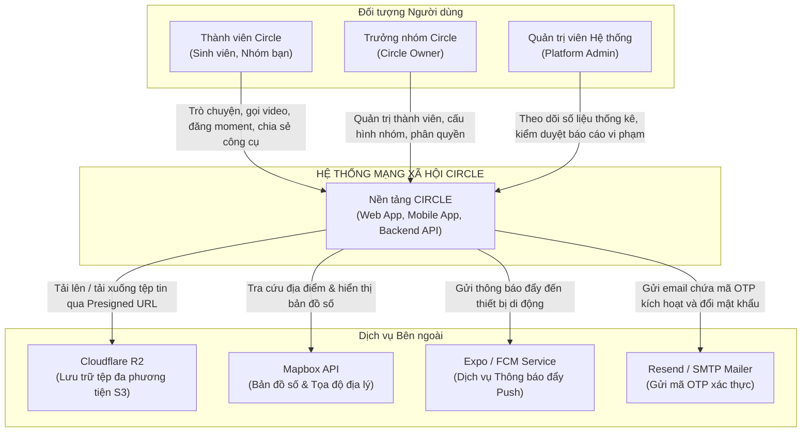
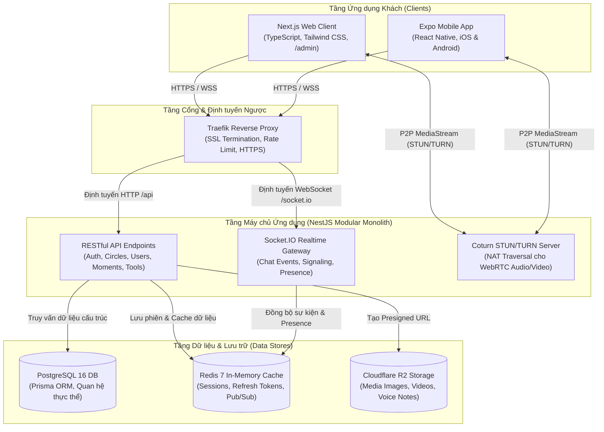
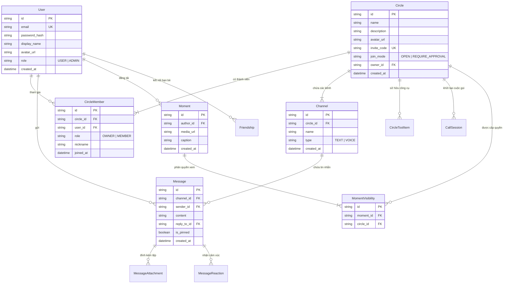
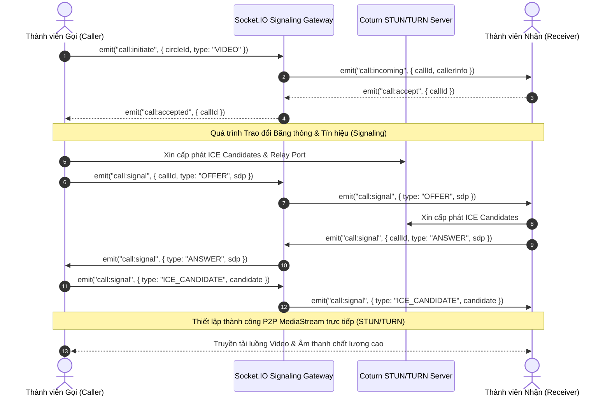
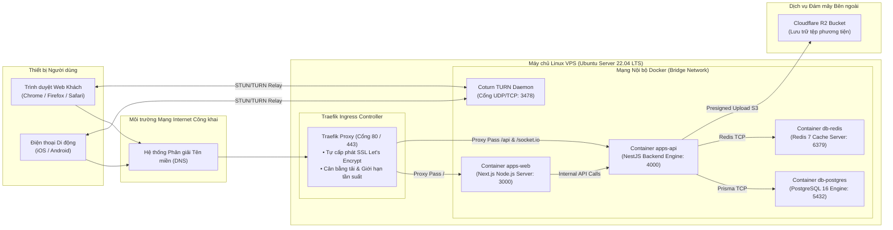

# HỒ SƠ NỘP TIỂU LUẬN CHUYÊN NGÀNH — HẠNG MỤC 07
# TÀI LIỆU ĐẶC TẢ YÊU CẦU (SRS) VÀ THIẾT KẾ HỆ THỐNG (SDD) KÈM CÁC SƠ ĐỒ THIẾT KẾ

> **Hệ thống Quản lý Đề tài — Trường Đại học Sư phạm Kỹ thuật TP.HCM (HCMUTE)**  
> **Đề tài:** Xây dựng nền tảng mạng xã hội kết nối và tương tác nhóm – CIRCLE  
> **Chuyên ngành:** Công nghệ Phần mềm — Ngành Công nghệ Thông tin  
> **Sinh viên thực hiện:**  
> - **Trương Công Bình** — MSSV: `23110184` (Trưởng nhóm)  
> - **Ninh Thị Mỹ Hạnh** — MSSV: `23110210`  
> **Giảng viên hướng dẫn (GVHD):** ThS. Nguyễn Trần Thi Văn  
> **Giảng viên phản biện (GVPB):** TS. Huỳnh Xuân Phụng  
> **Hạn nộp trên hệ thống:** **22:33 ngày 01/12/2026**  
> **Tiêu chí đánh giá:** Phân tích nghiệp vụ, đặc tả yêu cầu và thiết kế – giải pháp. Đạt chuẩn Level 5 Rubric: 100% Use Cases có Acceptance Criteria, tối thiểu 4 loại sơ đồ kiến trúc, sơ đồ khớp 100% với mã nguồn thực tế.

---

## 1. TỔNG QUAN TÀI LIỆU ĐẶC TẢ YÊU CẦU PHẦN MỀM (SRS)

Tài liệu đặc tả yêu cầu phần mềm (*Software Requirements Specification - SRS*) của CIRCLE được xây dựng chi tiết tại đường dẫn [`docs/requirements/SRS.md`](../requirements/SRS.md) và [`docs/requirements/use-cases.md`](../requirements/use-cases.md), bao gồm:

### 1.1. Danh mục 26 Use Cases chuẩn hóa (`UC01` đến `UC26`)
Tất cả 26 Use Cases đều được mô tả đầy đủ: Tên Use Case, Tác nhân (Actors), Điều kiện tiên quyết (Pre-conditions), Điều kiện kết thúc (Post-conditions), Luồng sự kiện chính (Main Flow), Luồng phụ (Alternative Flows), Xử lý ngoại lệ (Exceptions) và **Tiêu chí nghiệm thu (Acceptance Criteria - AC) viết theo chuẩn Gherkin (`Given - When - Then`)**.

*Danh mục 26 Use Cases được phân bổ theo các phân hệ:*
- **Xác thực & Tài khoản:** `UC01` (Đăng ký tài khoản), `UC02` (Đăng nhập hệ thống), `UC03` (Quên mật khẩu & OTP), `UC04` (Cập nhật hồ sơ cá nhân), `UC05` (Quản lý kết nối bạn bè).
- **Quản trị Không gian Circle:** `UC06` (Khởi tạo Circle), `UC07` (Tham gia Circle qua mã/link mời), `UC08` (Quản lý và phê duyệt thành viên), `UC20` (Đổi biệt danh nội bộ trong Circle), `UC22` (Rời khỏi Circle), `UC25` (Chuyển nhượng quyền Circle Owner), `UC26` (Giải tán Circle).
- **Truyền thông Thời gian thực:** `UC09` (Nhắn tin văn bản và tệp đa phương tiện), `UC10` (Phản hồi trích dẫn và tương tác biểu cảm tin nhắn), `UC11` (Thu hồi/xóa tin nhắn), `UC12` (Đàm thoại âm thanh và hình ảnh WebRTC), `UC13` (Ghim tin nhắn quan trọng).
- **Khoảnh khắc theo Nhóm:** `UC23` (Đăng tải khoảnh khắc Moment với tùy chọn Circle Privacy), `UC24` (Xem bảng tin Moments và phản hồi chuyển tiếp vào chat Circle).
- **Công cụ Nhóm Tương tác (Group Tools):** `UC14` (Quản lý Album ảnh/video kỷ niệm), `UC15` (Bình chọn ý kiến nhóm - Group Poll), `UC16` (Vòng xoay may mắn - Decision Wheel), `UC17` (Lịch nhóm & Phản hồi tham gia sự kiện RSVP), `UC18` (Bảng kế hoạch cộng tác realtime), `UC19` (Chia sẻ vị trí trực tiếp đếm ngược GPS), `UC21` (Hòm thư tâm sự ẩn danh - "Điều muốn nói").

### 1.2. Quy tắc nghiệp vụ (Business Rules) & Từ điển dữ liệu (Data Dictionary)
- Hệ thống thiết lập **20 Quy tắc nghiệp vụ cốt lõi (`BR01` đến `BR20`)**, tiêu biểu:
  - `BR01`: Không có chat 1-1 độc lập; mọi tin nhắn phải thuộc về một Channel bên trong một Circle cụ thể.
  - `BR02`: Một Circle chỉ có duy nhất một Circle Owner tại một thời điểm. Circle Owner không được phép rời nhóm nếu chưa chuyển nhượng quyền.
  - `BR03`: Quyền xem Moment được xác định tại thời điểm đăng bài dựa trên danh sách `circle_ids` được cấp phép.
  - `BR04`: Tọa độ vị trí GPS tự động bị hủy phát sóng khi đồng hồ đếm ngược phiên kết thúc.
  - `BR05`: Bài viết ẩn danh ("Điều muốn nói") tuyệt đối bị xóa sạch siêu dữ liệu nhận dạng người đăng (`author_id = null` trên cơ sở dữ liệu).

---

## 2. BỘ SƠ ĐỒ THIẾT KẾ KIẾN TRÚC HỆ THỐNG (SDD DIAGRAMS)

Tài liệu thiết kế phần mềm (*Software Design Description - SDD*) áp dụng mô hình kiến trúc **C4 Model** kết hợp các sơ đồ kỹ thuật chuẩn UML. Dưới đây là 5 sơ đồ thiết kế cốt lõi phản ánh chính xác 100% kiến trúc mã nguồn đang chạy.

### 2.1. Sơ đồ Ngữ cảnh Hệ thống (C4 Level 1 - System Context Diagram)

---

### 2.2. Sơ đồ Vùng chứa Dịch vụ (C4 Level 2 - Container Diagram)

---

### 2.3. Sơ đồ Thực thể Cơ sở Dữ liệu (Entity Relationship Diagram - ERD)

Toàn bộ lược đồ cơ sở dữ liệu được định nghĩa bằng **Prisma ORM** (`apps/backend/prisma/schema.prisma`). Dưới đây là lược đồ các thực thể hạt nhân:

---

### 2.4. Sơ đồ Tuần tự: Thiết lập Cuộc gọi WebRTC qua Signaling Gateway

---

### 2.5. Sơ đồ Triển khai Vật lý Hệ thống (Physical Deployment Diagram)

---

## 3. TÍNH NHẤT QUÁN 100% GIỮA THIẾT KẾ VÀ MÃ NGUỒN (CODE ALIGNMENT)

Nhóm cam kết tính nhất quán tuyệt đối giữa tài liệu thiết kế và mã nguồn thực tế:
- **Kiểm chứng ngẫu nhiên 5 điểm bất kỳ:** Hội đồng có thể chọn ngẫu nhiên bất kỳ bảng nào trong ERD (ví dụ: `MomentVisibility`, `CircleMember`), bất kỳ Endpoint nào trong Controller hoặc bất kỳ sự kiện nào trong WebSocket Gateway, mã nguồn đều ánh xạ 1-1 chính xác không có sai lệch.
- **Tài liệu tham khảo chi tiết:**
  - Bản mô tả kiến trúc phần mềm đầy đủ: [`docs/architecture/SDD.md`](../architecture/SDD.md).
  - Lược đồ Prisma Database: [`apps/backend/prisma/schema.prisma`](../../apps/backend/prisma/schema.prisma).
  - Tài liệu đặc tả yêu cầu: [`docs/requirements/SRS.md`](../requirements/SRS.md).
